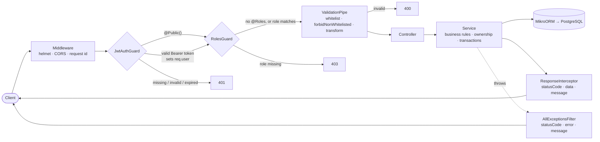
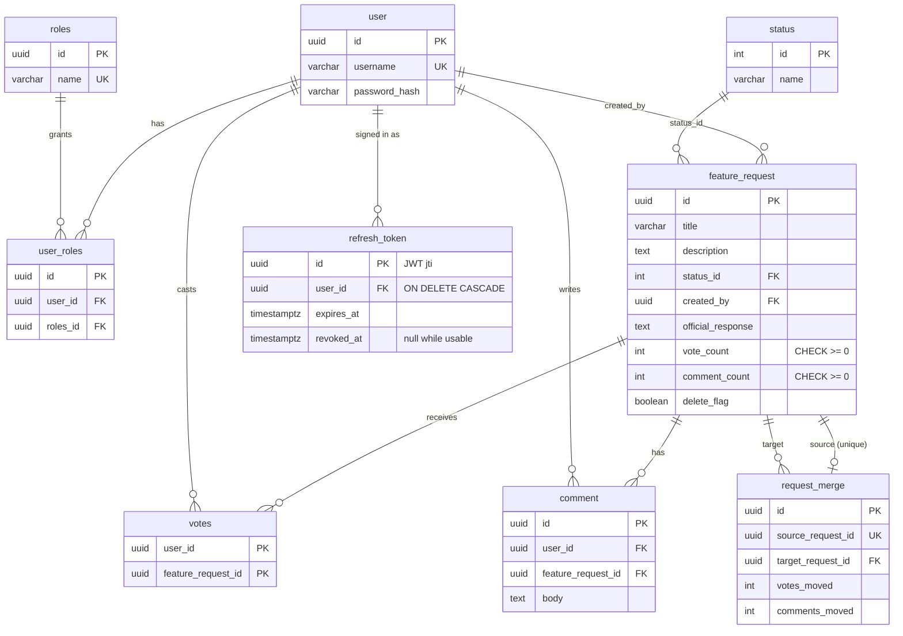
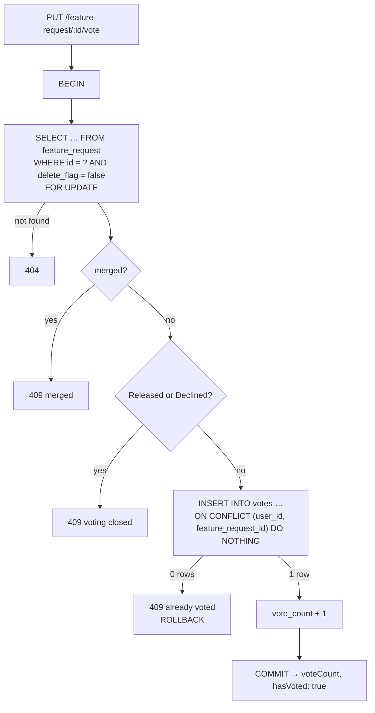
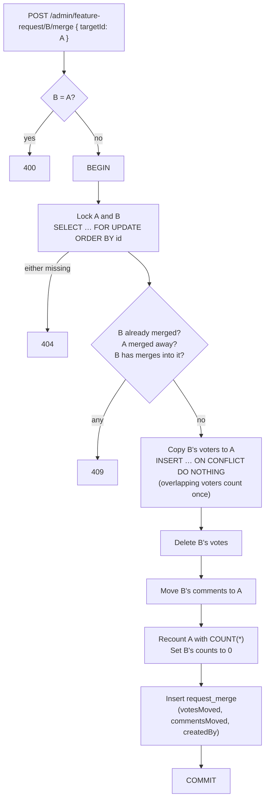

# Feature Voting — API

Backend for a product-feedback platform: users submit feature requests, vote,
comment and follow progress; admins change status, post official responses,
merge duplicates and view usage statistics.

NestJS 11 · MikroORM 7 · PostgreSQL · JWT · class-validator · Jest

> **Scope of this submission:** the backend vertical slice is complete. The
> Angular frontend is in [`../web`](../web/README.md) and the whole stack runs
> with one `docker compose up` from the [repository root](../README.md).
> Real-Postgres concurrency tests are not done — see [Scope](#scope).

---

## Contents

- [Quick start](#quick-start)
- [Architecture](#architecture)
- [Data model](#data-model)
- [API](#api)
- [Integrity: authorization, transactions, uniqueness, concurrency](#integrity)
- [Decisions and rejected alternatives](#decisions-and-rejected-alternatives)
- [Testing](#testing)
- [Operations](#operations)
- [Scope](#scope)
- [Risks and next steps](#risks-and-next-steps)
- [Time spent](#time-spent)

---

## Quick start

**Prerequisites:** Node ≥ 22.12 (MikroORM 7 is ESM-only) and a PostgreSQL you
can reach.

```bash
cp .env.example .env
```

Edit `.env`:

| Variable | What to set |
| --- | --- |
| `POSTGRES_*` | Your Postgres connection. Tables go in `POSTGRES_SCHEMA` (default `feature_dev`). |
| `JWT_SECRET`, `JWT_REFRESH_SECRET` | Two **different** secrets, ≥ 32 chars each: `openssl rand -base64 48` |
| `SEED_ADMIN_PASSWORD`, `SEED_USER_PASSWORD` | Passwords for the seeded users, ≥ 8 chars |

Startup fails with every problem listed if a required value is missing or
malformed ([`env.validation.ts`](src/config/env.validation.ts)).

```bash
npm ci
npm run migration:up     # create the schema
npm run seed             # 5 statuses, 2 roles, admin + user1..user3
npm run start:dev
```

| | URL |
| --- | --- |
| API | `http://localhost:3000/feature-voting/v1` |
| Swagger | `http://localhost:3000/feature-voting/api-docs` — log in, then **Authorize** with the `accessToken` |
| Probes | `http://localhost:3000/health`, `http://localhost:3000/ready` |

Seeded logins: `admin` / `SEED_ADMIN_PASSWORD`, and `user1`–`user3` /
`SEED_USER_PASSWORD`.

**Tests:** `npm test` (unit, no database needed). See [Testing](#testing).

**Everything in Docker** (Postgres, API, seed, web): see the
[root README](../README.md#run-everything-with-docker).

**Docker image:** `docker build -t feature-voting-api .` builds a multi-stage
image that runs as the unprivileged `node` user on port 3000 and applies
migrations on start. Pass configuration as environment variables; nothing is
baked in (`.env` is excluded by `.dockerignore`).

---

## Architecture

### Modules

| Module | Responsibility |
| --- | --- |
| `login` | `POST /auth/login`, `/auth/refresh`, `GET /auth/me`; registers the global `JwtAuthGuard` and `RolesGuard` |
| `user` | Entities `User`, `Role`, `UserRole`; admin-only create/get user |
| `feature-request` | Requests, comments, votes, statuses — list, detail, create, edit, soft delete, vote/unvote, comment |
| `admin` | Status changes, official responses (`AdminService`) and merges (`MergeService`) |
| `reporting` | Admin statistics |
| `health` | Liveness and readiness probes |

Cross-cutting pieces live in [`src/common/`](src/common/): guards,
decorators (`@Public`, `@Roles`, `@CurrentUser`, `@ResponseMessage`), the
response interceptor, the exception filter, the logger, date/query/password
utils and seeders.

### Request pipeline



**Response shapes.** Success: `{ statusCode, data?, message? }`. Error:
`{ statusCode, error, message, path, timestamp }`. 5xx messages are replaced
with a generic one so SQL and driver text never reach the client; the detail
goes to the error log.

---

## Data model



Audit columns (`created_at`, `updated_at`, `created_by`, `updated_by`,
`official_response_at/_by`) are omitted above. All timestamps default to
`now()` in the database so raw inserts work.

**Key constraints**

| Constraint | Enforces |
| --- | --- |
| `votes` PK `(user_id, feature_request_id)` | One vote per user per request |
| `request_merge.source_request_id` UNIQUE | A request is merged at most once |
| `CHECK (source_request_id <> target_request_id)` | No self-merge |
| `CHECK (vote_count >= 0)`, `CHECK (comment_count >= 0)` | Counters never go negative |
| `user.username` UNIQUE, `roles.name` UNIQUE, `user_roles (user_id, roles_id)` UNIQUE | No duplicate identities or role grants |

**Indexes:** `feature_request (status_id)`, `(vote_count DESC)`,
`(created_at DESC)`; `comment (feature_request_id, created_at)`;
`votes (feature_request_id)` (the PK leads with `user_id`);
`request_merge (target_request_id)`; `refresh_token (user_id)`.

**Statuses** (seeded): 1 Under Review · 2 Planned · 3 In Progress ·
4 Released · 5 Declined. Released and Declined are *closed*: votes are frozen.

**Migrations** are in [`migrations/`](migrations/), generated from the entities
and reviewed by hand. The app applies pending migrations on boot under a
Postgres advisory lock, so replicas starting together don't race.

---

## API

All paths are under `/feature-voting/v1`. Every route needs a Bearer access
token unless marked public.

| Method | Path | Access | Notes |
| --- | --- | --- | --- |
| POST | `/auth/login` | public | `{ username, password }` → `{ accessToken, refreshToken }` |
| POST | `/auth/refresh` | public | `{ refreshToken }` → new pair; the token sent is revoked (single use); roles reloaded from the DB |
| POST | `/auth/logout` | public | `{ refreshToken }` → revokes it; always 200 |
| GET | `/auth/me` | user | `{ id, name, roles[] }` |
| GET | `/feature-request` | user | `q`, `status`, `fromDate`/`toDate` (`DD-MM-YYYY`), `sort=votes\|new`, `limit`, `offset`. Excludes merged and deleted. Each item has `hasVoted`, `canVote`. |
| GET | `/feature-request/status` | public | The 5 statuses |
| GET | `/feature-request/:id` | user | Detail with `hasVoted`, `canVote`, `mergedInto { id, title, mergedAt, mergedBy }`, `mergedFrom[]` |
| POST | `/feature-request` | user | Create; starts as Under Review |
| PATCH | `/feature-request/:id` | owner | 403 for others, 409 if merged |
| DELETE | `/feature-request/:id` | owner | Soft delete; 409 if part of a merge |
| PUT | `/feature-request/:id/vote` | user | → `{ voteCount, hasVoted }`; 409 if already voted, merged, or closed |
| DELETE | `/feature-request/:id/vote` | user | → `{ voteCount, hasVoted }`; no-op if not voted; 409 if merged or closed |
| GET | `/feature-request/:id/comments` | user | Newest first, `limit`/`offset` |
| POST | `/feature-request/:id/comments` | user | 409 if merged |
| PATCH | `/admin/feature-request/:id/status` | admin | `{ statusId }` |
| PUT | `/admin/feature-request/:id/response` | admin | `{ response }` |
| POST | `/admin/feature-request/:id/merge` | admin | `{ targetId }` → merge record incl. `votesMoved`, `commentsMoved`, `createdBy` |
| GET | `/admin/reporting` | admin | Totals, counts per status, top 5 voted, oldest 10 Under Review; optional `fromDate`/`toDate` |
| POST | `/user` | admin | `{ name, username, password, role }`; 409 on duplicate username |
| GET | `/user/:id` | admin | `{ id, name, username, roles[], createdAt }` |

Every `:id` is checked with `ParseUUIDPipe`, so a malformed id is a 400, not a
database error.

---

<a id="integrity"></a>

## Integrity: authorization, transactions, uniqueness, concurrency

### Authorization

| Rule | Where it's enforced |
| --- | --- |
| Every route needs a valid access token | Global `JwtAuthGuard`; `@Public()` opts out (login, refresh, logout, statuses, probes) |
| Only admins change status, respond, merge, report, manage users | Global `RolesGuard` + `@Roles(ROLE.ADMIN)` on those controllers → 403 |
| A user can't edit or delete another user's request | Owner check in `FeatureRequestService` → 403 |
| Merged requests are read-only | Service checks → 409 |
| Hiding admin UI in the frontend | Cosmetic only — the server decides |

### Login and tokens

```mermaid
sequenceDiagram
    participant C as Client
    participant A as /auth
    participant DB as PostgreSQL
    C->>A: POST /auth/login {username, password}
    A->>DB: find user + roles by username
    A->>A: bcrypt compare (against a dummy hash if no user)
    alt wrong username or password
        A-->>C: 401 "Invalid username or password" (same for both)
    else ok
        A->>DB: INSERT refresh_token (id = jti, expires_at)
        A-->>C: accessToken {sub, name, roles[]} (15m, JWT_SECRET)<br/>refreshToken {sub, jti} (7d, JWT_REFRESH_SECRET)
    end
    C->>A: POST /auth/refresh {refreshToken}
    A->>DB: BEGIN; SELECT refresh_token WHERE id = jti AND user_id = sub FOR UPDATE
    alt missing or revoked
        A-->>C: 401
    else usable
        A->>DB: revoked_at = now(); reload user + roles; INSERT new refresh_token; COMMIT
        A-->>C: new pair (role changes apply here)
    end
    C->>A: POST /auth/logout {refreshToken}
    A->>DB: UPDATE refresh_token SET revoked_at = now() WHERE id = jti
    A-->>C: 200 (also for invalid or already revoked tokens)
```

- Passwords are hashed with bcrypt (12 rounds) and limited to 72 bytes, bcrypt's
  real limit.
- Access and refresh tokens use different secrets, so neither can stand in for
  the other. Both verify with `HS256` only.
- Usernames are trimmed and lower-cased on create and login.
- **Refresh tokens are single use.** Each carries a `jti` stored in
  `refresh_token`; refresh revokes it and issues a new one. The row lock means
  two concurrent refreshes with the same token can't both succeed. The token
  itself isn't stored: a `jti` is useless without a token signed with
  `JWT_REFRESH_SECRET`.
- **Logout revokes** the refresh token. Like OAuth token revocation (RFC 7009)
  it always answers 200, so it doesn't reveal whether a token was live.
- Expired rows for a user are deleted at their next login.
- **Access tokens are not revocable:** they stay valid until they expire
  (15 minutes), the accepted cost of not checking the database on every
  request.

### Voting



- **Once per user:** the `votes` primary key. Duplicates can't exist even if
  application code were wrong.
- **Repeated requests don't create duplicates:** `ON CONFLICT DO NOTHING`, and
  the counter only moves when a row was actually inserted (or, for unvote,
  deleted).
- **Concurrent votes can't lose updates:** the request row is locked
  (`FOR UPDATE`) for the transaction, so votes on the same request queue and
  each sees the previous count. The same lock serialises votes with comments
  and merges on that request.
- **Unvote** mirrors it: `DELETE`; decrement only if a row was deleted; no vote
  is a no-op returning 200.

### Merging duplicates

Merging B into A moves B's activity to A and leaves B as a read-only pointer.



After a merge:

- **B** keeps its row, title and history. It's hidden from lists and stats,
  every write to it returns 409, and its detail shows `mergedInto` so the UI
  can link to A.
- **A** gains B's unique voters and all comments (original authors and times
  kept) and lists B in `mergedFrom`.
- **Chains are blocked** (B→A→C): a target with merges can't itself be merged,
  and a merged request can't be merged again (also enforced by the unique
  `source_request_id`). Redirects therefore never take more than one hop.
- A request that's part of a merge **can't be deleted**, so B's link can't be
  orphaned.

### Transaction boundaries

| Operation | In one transaction |
| --- | --- |
| Vote / unvote | lock request → checks → insert/delete vote → update count |
| Add comment | lock request → checks → insert comment → `comment_count + 1` |
| Merge | lock both → checks → move votes → move comments → recount → record |
| Create user | user row + role row (one flush) |

Single-row updates (edit, soft delete, status, response) rely on one flush,
which MikroORM wraps in a transaction.

---

## Decisions and rejected alternatives

| Decision | Why | Rejected |
| --- | --- | --- |
| **Row lock (`FOR UPDATE`) + `ON CONFLICT`** for vote counts | Correct under concurrency, expressible in MikroORM without raw SQL, and the same lock serialises votes, comments and merges on a request. | Atomic `UPDATE … SET vote_count = vote_count + 1` without a lock: also correct and slightly faster, but needs raw SQL and doesn't coordinate with merges. Computing counts with `COUNT(*)` on every read: simpler, but slow for sorted lists. |
| **Denormalised `vote_count` / `comment_count`** | Lists sort by votes; a counter column with an index keeps that one indexed scan. | Live counts per list query. |
| **Repeat vote → 409** | Requested product behaviour: the user is told they already voted. | Fully idempotent 200. The database state is still idempotent; only the response differs, so clients retrying a vote should treat this 409 as success. |
| **Votes frozen on Released / Declined** (vote and unvote → 409) | A decision has been made; the count is a record. `canVote` tells the UI. | Allowing unvote after closing. |
| **Merges in a `request_merge` table**, not a self-FK on `feature_request` | Keeps an audit row (who, when, how much moved) and makes "merged" a simple existence check. | `merged_into_id` column on the request. |
| **Merged-request exclusion via MikroORM `merges: { $none: {} }`** | Pure ORM, no raw SQL; generates `id NOT IN (subquery)`, equivalent to `NOT EXISTS` here because `source_request_id` is never null. | A raw `NOT EXISTS` helper. |
| **Soft delete (`delete_flag`) with a default MikroORM filter** | Every ORM query skips deleted rows automatically; history kept. | Hard delete (would drop other users' comments); `deleted_at` timestamp. |
| **Comments on their own paginated endpoint** | Detail stays at 4 parallel queries; comments load on demand with an index-backed `LIMIT/OFFSET`. | Populating `comments` on the request: MikroORM's per-parent limit uses `row_number()` over every comment and adds a sequential round trip. |
| **`limit` / `offset` paging** | Simple, matches the UI; `offset` capped at 10 000. | Cursor paging — better for deep pages, not needed at this size. |
| **Stateless JWT access (15m) + single-use refresh (7d) tracked by `jti`, separate secrets** | Access checks need no database; refresh and logout can revoke, so a copied refresh token stops working once used or logged out. Role changes apply at the next refresh. | Fully stateless refresh tokens: simpler, but a stolen token works for 7 days and logout is client-only. A `token_version` column on `user`: one migration column, but every refresh or login logs out the user's other devices and tabs. Passport: one more dependency for what a 40-line guard does. |
| **bcrypt** for passwords | Standard, well understood. | Node's built-in `scrypt` (no native dependency). |
| **Explicit `fromDate` / `toDate` as `DD-MM-YYYY`, whole days in `+08:00`** | Matches how users think about dates; `toDate` is inclusive. | ISO timestamps from the client. |
| **Validation with class-validator DTOs and `forbidNonWhitelisted`** | Unknown fields are a 400, which also blocks mass assignment. | Silently stripping unknown fields. |

---

## Testing

```bash
npm test          # unit tests, mocked EntityManager — no database
npm run test:cov  # with coverage
npm run test:e2e  # existing e2e suite (needs Postgres)
```

**137 unit tests in 21 suites.** The business-rule ones:

| Spec | Covers |
| --- | --- |
| `common/guards/roles.guard.spec.ts` | admin passes, multi-role passes, `user` / no roles / no user → 403 |
| `common/guards/jwt-auth.guard.spec.ts` | public routes; missing, malformed, tampered, expired tokens and a refresh token used as access → 401 |
| `login/login.service.spec.ts` | roles in the token; wrong password and unknown user give the same 401; login stores the `jti` row and clears expired ones; refresh rotates (old revoked, new row), locks the row, and rejects reused, unknown, pre-rotation, access and deleted-user tokens; logout revokes, and ignores junk |
| `feature-request/feature-request.service.spec.ts` | vote +1 only on insert; repeat → 409, count unchanged; lock taken; closed and merged → 409; unvote no-op; edit/delete 404 / 403 (not owner) / 409 (merged) with no write |
| `admin/merge.service.spec.ts` | self → 400 with no DB access; missing → 404; three chain cases → 409; lock order; overlapping voters counted once; recount; `votesMoved` |
| `admin/admin.service.spec.ts` | status/response 404 and 409 |
| `…/list-feature-request-query.dto.spec.ts`, `…/feature-request-input.dto.spec.ts`, `user/dtos/add-user.dto.spec.ts` | the real `ValidationPipe` settings: defaults, trimming (title, description), every rejected input |

**What these don't prove.** The unit tests check the decisions and that the
right lock and `ON CONFLICT` are requested. That 50 concurrent votes end at
exactly 50 depends on Postgres honouring them, and needs an integration test
against a real database — listed under [next steps](#risks-and-next-steps).

**CI gates** (no pipeline ships; these are the commands to wire up):
`npm run lint:check` · `npm run typecheck` · `npm test` ·
`npm run check:migrations` (fails if an entity changed without a migration) ·
`npm run build`.

---

## Operations

### Logging

Structured JSON (timestamp, level, `service`, `requestId`, `label`, stack) to
stdout **and** daily files under `LOG_DIR` (default `logs/`):

| Folder | Contains |
| --- | --- |
| `logs/applications/` | everything at `LOG_LEVEL` and above (default `http`, one line per request) |
| `logs/errors/` | errors only, with stack — the first place to look |
| `logs/exceptions/` | uncaught exceptions and unhandled rejections |

Files rotate daily, older ones are gzipped, and anything older than 14 days is
deleted. Every request gets an `x-request-id` (accepted from the client if
safe, otherwise generated), returned in the response and written on every log
line, so `grep <request-id> logs/errors/*.log` finds a failure. In Docker,
mount a volume at `/app/logs` to keep them.

### Configuration and HTTP hardening

- All configuration is validated at startup; `.env.example` lists every
  variable and contains no secrets.
- `helmet`; CORS is an explicit allowlist (`CORS_ORIGINS`) with credentials
  off.
- Swagger is off when `NODE_ENV=production` unless `SWAGGER_ENABLED=true`.
- Set `TRUST_PROXY_HOPS` to the number of proxies in front of the app, or every
  request logs the proxy's address.

### Health

`GET /health` is liveness only (never touches the database). `GET /ready`
returns 503 when the database is unreachable or the process is shutting down.
Both sit outside the API prefix.

---

## Scope

**Complete (backend)**

- JWT login / refresh / logout / me; single-use refresh tokens with
  revocation; user and admin roles; multiple roles per user
- Browse with search, status filter, created-date range, sort, paging
- Create, view, edit (owner), soft delete (owner)
- Vote / unvote with once-per-user, concurrency and closed-status rules
- Comments with counts; paginated comment list
- Admin: status, official response, merge with full activity transfer, statistics
- Admin user management (create, get)
- Migrations, seeders, validated config, structured logs with daily files
- Multi-stage Dockerfile and `.dockerignore`; `docker-compose.yml` at the
  repository root (Postgres, API, idempotent seed, web)
- 137 unit tests
- Angular frontend (see [`../web`](../web/README.md))

**Partial**

- **Tests** are unit tests with mocks; no real-Postgres integration tests for
  the concurrency and merge rules yet.
- **Seed data** has statuses, roles and users, but no sample feature requests.

**Deferred on purpose**

- Undoing a merge (would need the original voters/comments recorded at merge time)
- Refresh-token reuse detection (revoking all of a user's tokens when a used
  one is presented again)
- Notifications to authors and voters (e.g. when a request is merged or released)
- Trigram index (`pg_trgm`) for `ILIKE '%…%'` search at scale
- Audit log beyond the `created_by` / `updated_by` columns

**Left out on purpose**

- **Rate limiting.** Enforced at the edge (nginx, the Kubernetes ingress or the
  gateway in front of the service), not in application code. One place to tune
  it for every service, and abusive traffic is dropped before it reaches Node.
  Correctness doesn't depend on it: a burst of repeated votes still counts
  once (votes primary key + `ON CONFLICT`).

---

## Risks and next steps

**Known risks**

1. **Concurrency is designed, not yet proven by a database test.** The
   guarantees rest on the votes PK, `FOR UPDATE` and `ON CONFLICT`.
2. **Repeat vote returns 409.** A client that retries a vote after a network
   error must treat "already voted" as success.
3. **Role changes and logout lag up to 15 minutes** for access tokens, which
   are not checked against the database. A stolen refresh token works until
   its owner refreshes or logs out; there is no reuse detection yet.
4. **Hot requests serialise votes.** Every vote on one request waits for the
   row lock — fine here, a bottleneck for a single viral request.
5. **`ILIKE '%q%'` search** scans the table.
6. **`bcrypt` is a native module;** confirm it loads in the Alpine image.

**Next steps, in order**

1. Integration tests against real Postgres: 50 concurrent voters → 50; one user
   voting 10× concurrently → 1; merge with overlapping voters; non-admin → 403.
2. Seed ~10 sample requests with votes and comments.
3. Refresh-token reuse detection, the refresh token in an httpOnly cookie, and
   a scheduled cleanup of expired `refresh_token` rows.
4. A `pg_trgm` search index.
5. CI running the gates above for the API and the web app.

---

## Time spent

_To be filled in before submission._ Git history covers 21 Nov 20:35 → 22 Nov
00:41; that doesn't include planning before the first commit.
